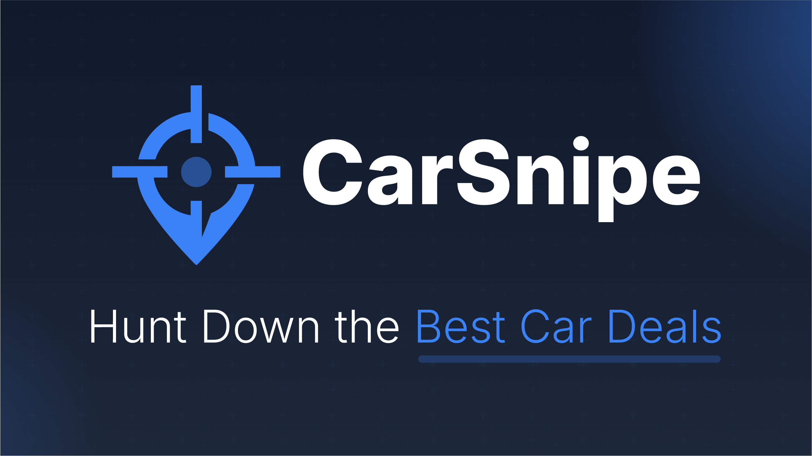

  

  <strong>Monitor Facebook Marketplace 24/7 and get instant Telegram alerts for new vehicle listings.</strong>

  
  
  

---

## What is CarSnipe?

CarSnipe is a Windows desktop agent that monitors Facebook Marketplace for used vehicles and sends you instant alerts via Telegram. Stop refreshing — let CarSnipe watch for you.

**How it works:**
1. The agent runs quietly in your system tray
2. It checks Facebook Marketplace on your configured schedule
3. When a new listing matches your search criteria, you get a Telegram notification within minutes

## Features

- **Instant Alerts** — Get notified via Telegram the moment a matching vehicle is listed
- **Multiple Searches** — Monitor different makes, models, price ranges, and locations
- **Price Drop Alerts** — Know when sellers lower their prices (Pro plan)
- **Runs in Background** — Minimal CPU and memory usage, sits in your system tray
- **Privacy First** — Your Facebook credentials stay on your machine, encrypted locally

## Quick Start

1. **Download** [`CarSnipe_Installer.exe`](https://github.com/Concept211/CarSnipe/releases/latest/download/CarSnipe_Installer.exe) and run it
2. **Pair with Telegram** — Send `/connect` to [@CarSnipeBot](https://t.me/CarSnipeBot) and enter the pairing code
3. **Log into Facebook** — The agent opens a browser window for a one-time login
4. **Start monitoring** — Your 7-day free trial begins automatically

## System Requirements

| Requirement | Minimum |
|---|---|
| OS | Windows 10 or 11 |
| RAM | 4 GB |
| Disk | ~100 MB |
| Internet | Required |
| Facebook | Account required |

## Pricing

| | Basic | Pro |
|---|---|---|
| Monthly | $9.99/mo | $24.99/mo |
| Yearly | $99/yr | $249/yr |
| Searches | 2 | Unlimited |
| Check interval | 15 min | 3 min |
| Price drop alerts | — | Included |

All plans include a **7-day free trial** — no credit card required.

## Security & Privacy

- Facebook credentials are stored **locally on your computer** in encrypted form
- Credentials are **never** transmitted to CarSnipe servers
- The agent uses a standard browser session — the same as you opening Facebook yourself
- No data scraping or account automation that violates Facebook's terms

## Support

- **Website:** [carsnipe.com](https://carsnipe.com)
- **Telegram Bot:** [@CarSnipeBot](https://t.me/CarSnipeBot)
- **Issues:** [GitHub Issues](https://github.com/Concept211/CarSnipe/issues)

## License

CarSnipe is proprietary software. This repository hosts official releases only.
